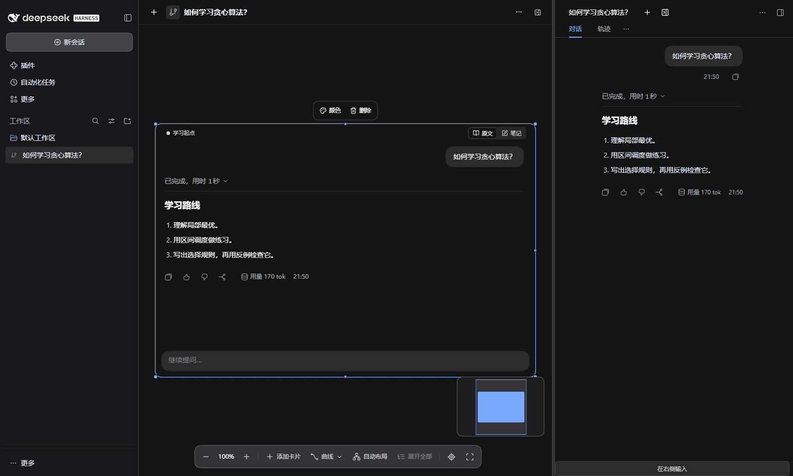

<p align="center"></p>
<h1 align="center">dsh-tree</h1>
<p align="center">Branch your learning conversations in DeepSeek Harness.</p>
<p align="center"><a href="README.md">简体中文</a> · English</p>



<sub>Recorded in DSH 0.2.2-rc.5 with sample model responses.</sub>

## Why learning conversations branch

A traditional session puts every question and answer on one timeline. Suppose you are learning greedy algorithms and come across “local optimum.” Branch from that phrase, explore it, then return to the original answer and continue with interval scheduling. Any branch can branch again, and each detour keeps its starting point.

The canvas has three kinds of cards. **Q&A cards** hold conversations, **Markdown cards** organize notes, and **code cards** hold editable examples. All three can live in the same tree.

## One session file holds the whole tree

One study tree maps to one DeepSeek Harness session. Its turns, material cards, and parent relationships are recorded in a single append-only session log. When the session reopens, those relationships reconstruct the tree. A follow-up from an earlier card uses conversation history along its ancestor path while other branches stay on the canvas.

## Quick install

Requires **DSH Desktop `0.2.2-rc.5`**. Once you have the built `dsh-study-tree-0.9.0-rc.1.tgz` package, quit DSH, install it with the DSH CLI, and reopen the app:

```powershell
dsh plugin --profile desktop add (Resolve-Path './dsh-study-tree-0.9.0-rc.1.tgz').Path
```

Choose **Start with a study canvas** on the new session screen. The plugin uses your existing DSH model configuration.

**Plugin marketplace.** Enable **Custom Plugin Index** under **Plugins → Experimental Plugins**. In **Discover → Add Index Source**, add an index that lists the plugin, then search for `dsh-study-tree`. The project has yet to publish a marketplace index or a public installer. [See Releases](https://github.com/sunmingqi-1/dsh-tree/releases)
