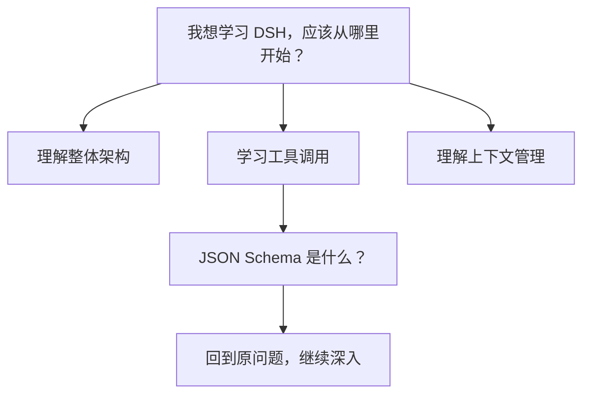

<div align="center">


# dsh-tree

### 把一次聊天，长成一棵知识树。

基于 **DeepSeek Harness** 的树形学习插件。用无限画布组织问答，从不理解的原文展开分支，学完再回到主线。

[](LICENSE)
[](#兼容与版本)
[](#安装)

[快速开始](#安装) · [使用方法](#如何使用) · [参与贡献](CONTRIBUTING.md) · [反馈问题](https://github.com/sunmingqi-1/dsh-tree/issues)

</div>

---

## 为什么做学习树

让 AI 解释一个新领域时，你往往会在回答里遇到另一个陌生概念。继续追问、再继续追问，最初的问题就淹没在长长的聊天记录里。

学习树让这些岔路保留下来：**一个节点就是一问一答，一个分支就是一次深入。** 你可以沿着感兴趣的概念向下探索，也可以随时返回原来的问题。整个学习过程逐渐成为一份有结构的笔记。



*学习路径示意；实际界面为可拖动、缩放的无限画布。*

## 你可以做什么

| 能力 | 用起来是什么样 |
| --- | --- |
| **树形问答** | 每个节点保存一次提问和 Agent 回答，沿任意已完成节点继续提问。 |
| **划词引用与分支** | 选中回答里的词句，先选择添加到卡片输入框，或在分支中提问；引用保留来源，发送后可返回原文。 |
| **无限画布** | 拖动、滚轮缩放、调整卡片尺寸，用自动布局整理学习路径。 |
| **原生工作区目录** | 学习主题和分支直接在 DSH 左侧工作区中分层展示。 |
| **路径阅读** | 右侧复用 DSH 原生对话，只显示从根到当前选中节点的历史；可拖宽、隐藏。 |
| **Markdown 内容** | 阅读标题、列表、代码和公式，长回答在卡片中独立滚动。 |
| **布局与导航** | 向下生长的布局、曲线或圆角折线、小地图，以及调整卡片时的相邻节点避让。 |
| **笔记导出** | 将当前路径或整棵学习树导出为 Markdown。 |

插件沿用 DSH 的默认配色和输入组件，支持深色、浅色主题。模型选择、权限和会话执行由 DSH 提供。

## 兼容与版本

| 分支 | 定位 | 状态 |
| --- | --- | --- |
| **`main`** | 稳定版本 | 0.6.4，本文安装步骤默认使用此分支。 |
| `feat/native-turn-cards` | 开发版本 | 0.7 系列，新增原生流式过程、过程折叠与卡片内提问/审批。 |

插件 `0.8.1` 适配 **DSH `0.2.2-rc.5`**，构建使用 **Node.js 24**。插件 `0.8.0` 对应 DSH `0.2.2-rc.3`。

开发版的覆盖范围见该分支的[原生单轮卡片验证](https://github.com/sunmingqi-1/dsh-tree/blob/feat/native-turn-cards/docs/原生单轮卡片验证.md)。开发版功能不会自动进入稳定分支。

本分支的单会话学习树需要配套的 DSH `feat/single-session-tree` 宿主和客户端。每棵新树使用一个会话，卡片和划词追问会沿选中的父轮次继续。旧版 fork 树可以回看。重新回答或改写根问题会建立新主题。

## 安装

先安装并运行 DeepSeek Harness，再在本地构建本插件：

```bash
git clone --branch main https://github.com/sunmingqi-1/dsh-tree.git
cd dsh-tree
npm ci
npm run build
```

在 DSH 的 **「插件 → 添加插件」** 中选择构建后的项目目录，并按界面提示启用。

本插件需要在 DSH 中运行，不是独立网页应用。无需为插件额外配置模型 API Key，继续使用 DSH 已配置的模型。

需要分发本地安装包时，可执行 `npm pack` 生成包含 Host 和浏览器产物的 `.tgz` 文件。目前未提供 npm 注册表安装方式。

## 如何使用

1. **开始一个主题。** 在新会话首页点击模式选择右侧的「学习画布」，输入第一个问题。
2. **沿节点追问。** 点击卡片，在其中的原生输入框继续提问，形成新的子节点。
3. **从原文展开。** 选中回答中的文字，右键输入问题；点击子节点的引用可以回到来源。
4. **整理学习路径。** 使用自动布局、连线切换和小地图；拖动卡片边缘调整阅读空间。
5. **回顾与导出。** 右侧阅读当前路径，或通过画布操作菜单导出 Markdown。

### 分支会继承哪些上下文？

追问以父节点**已完成轮次的结束位置**创建 DSH 会话分支，继承该位置之前的上下文。回到旧节点追问时，不会带入它后面的其他分支回答。

### 学习记录保存在哪里？

树结构和引用关系保存在当前 DSH 配置的存储中；画布视野、位置、尺寸及部分偏好保存在当前设备。模型调用与会话存储遵循 DSH 配置，插件没有额外的云同步服务。清理应用数据前，请先导出重要笔记。

### 缩小画布会隐藏正文吗？

不会。缩放只改变显示比例，正文仍然保留；长内容在卡片内滚动，卡片大小可以手动调整。

## 开发与贡献

```bash
npm test       # 验证历史隔离、布局、草稿和存储逻辑
npm run build  # 构建浏览器与 Host 入口
npm pack       # 生成安装包
```

```text
src/
  client/      无限画布、工作区目录与 DSH UI 适配
  host/        树记录存储及插件接口
test/          自动化测试
docs/          设计、开发计划和集成依据
```

欢迎提交可复现的 Bug、交互建议和 Pull Request。请先阅读[贡献指南](CONTRIBUTING.md)，涉及宿主适配或性能时说明 DSH 版本与测试环境。

## 文档

- [产品与交互设计](docs/设计文档.md)
- [开发计划](docs/开发计划.md)
- [DSH 插件接入依据](docs/DSH插件接入.md)
- [悬浮卡片与原生输入](docs/悬浮卡片与原生输入设计.md)
- [缩放性能验证](docs/缩放性能验证.md)

部分源码参考链接面向同级检出的 `deepseek-harness`，它不是构建插件时必须存在的依赖。

## 致谢与许可

感谢 DeepSeek Harness 提供宿主与插件能力，以及 [React Flow](https://github.com/xyflow/xyflow)、[Dagre](https://github.com/dagrejs/dagre)、[react-markdown](https://github.com/remarkjs/react-markdown) 等开源项目。

这是社区插件，与 DeepSeek 官方无隶属关系。采用 [MIT License](LICENSE)，第三方依赖遵循各自的许可证。
