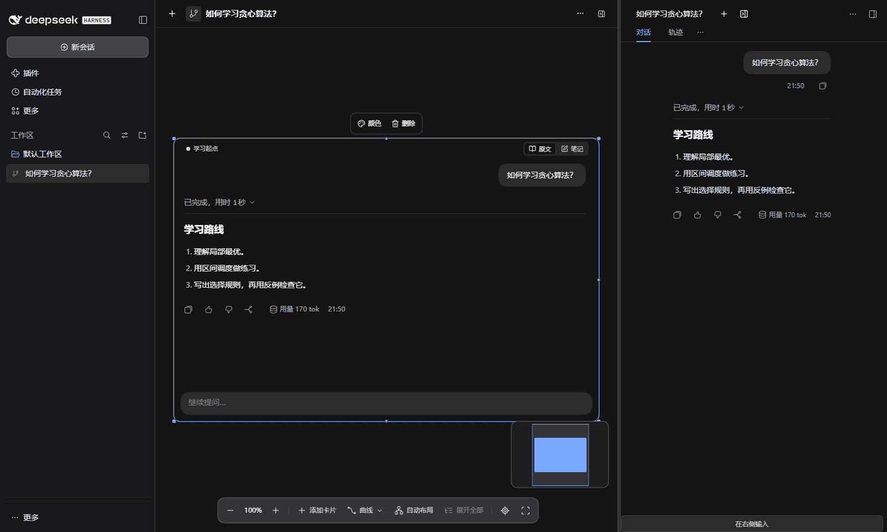

<p align="center"></p>
<h1 align="center">dsh-tree</h1>
<p align="center">给 DeepSeek Harness 的学习对话加一棵树。</p>
<p align="center">简体中文 · <a href="README.en.md">English</a></p>



<sub>在 DSH 0.2.2-rc.5 中录制，模型回复使用示例数据。</sub>

## 为什么学习对话需要一棵树

传统 Session 把问答排成一条线。学贪心算法时，如果回答提到不懂的「局部最优」，你可以从原文开一个分支。理解之后，回到原来的回答继续学区间调度。子分支也可以继续分叉，每条探索都有明确的起点。

画布上有三种卡片：**问答**用来追问，**Markdown**用来整理笔记，**代码**用来保存和编辑示例。它们可以放在同一棵树里，沿着原来的问题组织起来。

## 一个 Session 文件保存整棵树

dsh-tree 是 DeepSeek Harness 插件。一棵学习树对应一个 DSH Session，问答、资料卡和父节点关系记录在同一份会话日志文件中。日志按发生顺序追加，重新打开时按父节点关系还原树。从旧节点继续提问时，模型沿这条祖先路径读取对话历史，其他分支保留在画布上。

## 快速安装

当前适配 **DSH Desktop `0.2.2-rc.5`**。取得已构建的 `dsh-study-tree-0.9.0-rc.1.tgz` 后，退出 DSH，用 DSH 安装该包，再重启：

```powershell
dsh plugin --profile desktop add (Resolve-Path './dsh-study-tree-0.9.0-rc.1.tgz').Path
```

在新会话首页选择 **「以学习画布开始」**。使用 DSH 中已配置的模型即可。

**插件市场**：DSH 的入口是「插件 → 实验性插件 → 自定义插件索引」。启用后，在「发现 → 添加索引源」添加提供该插件的索引，再搜索「学习树」安装。项目目前尚未发布市场索引或公开安装包。[查看 Releases](https://github.com/sunmingqi-1/dsh-tree/releases)
