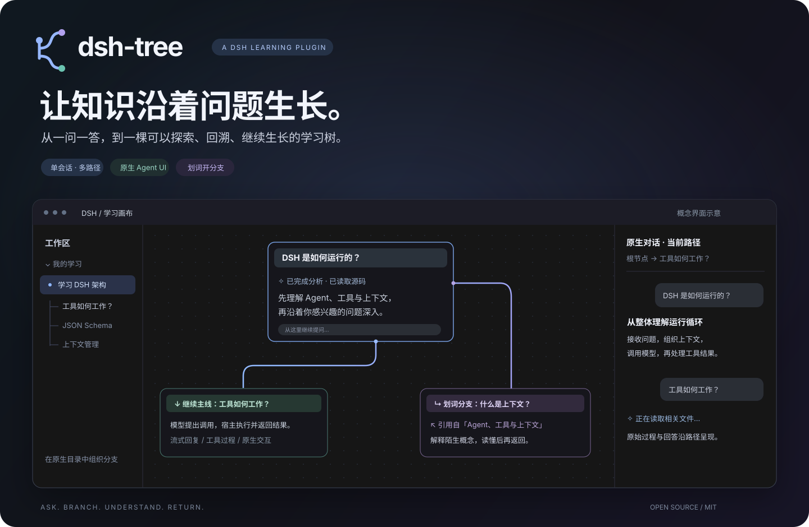
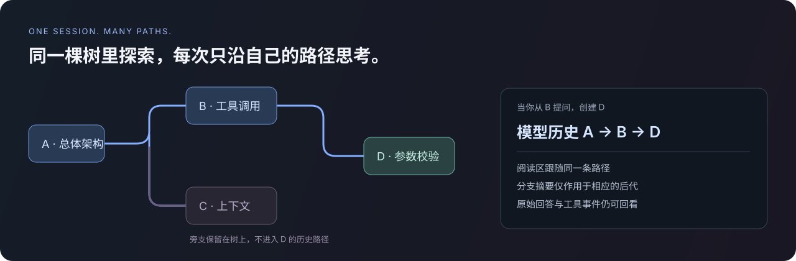

<p align="center">
  
</p>

<h1 align="center">dsh-tree</h1>

<h3 align="center">把一次聊天，长成一棵知识树。</h3>

<p align="center">
  DeepSeek Harness 的树形学习插件。<br/>
  遇到不懂的概念，就从原文长出一条分支；理解之后，回到主线继续。
</p>

<p align="center">
  <a href="LICENSE"></a>
  <a href="#版本与安装"></a>
  <a href="#版本与安装"></a>
  <a href="https://github.com/sunmingqi-1/dsh-tree/stargazers"></a>
</p>

<p align="center">
  <a href="#从一个问题开始"><strong>看它如何工作</strong></a> &nbsp;·&nbsp;
  <a href="#功能一览"><strong>探索功能</strong></a> &nbsp;·&nbsp;
  <a href="#版本与安装"><strong>安装与上手</strong></a> &nbsp;·&nbsp;
  <a href="CHANGELOG.md"><strong>更新日志</strong></a> &nbsp;·&nbsp;
  <a href="https://github.com/sunmingqi-1/dsh-tree/issues"><strong>反馈与建议</strong></a>
</p>

<p align="center">
  
</p>

<p align="center"><sub>原创界面示意，用于解释交互；不是运行截图。实际界面沿用 DSH 的默认配色，支持深色与浅色主题。</sub></p>

## 从一个问题开始

你让 AI 给出一份学习路线，却在第一段里遇到了陌生术语。追问术语，再追问解释里的新概念，原来的路线就逐渐埋进了聊天记录。

**dsh-tree 把这个过程保留下来：一张卡片是一轮问答，一条分支是一次深入。** 主线、岔路和原文来源都在同一张画布里，聊天本身逐渐成为有结构的学习笔记。

<table>
<tr>
<td width="33%" valign="top">
<strong>01 / 问一个问题</strong><br/><br/>
“我想学习 DSH，应该从哪里开始？”<br/>
第一轮问答成为学习树的根节点。
</td>
<td width="33%" valign="top">
<strong>02 / 顺着好奇心深入</strong><br/><br/>
在卡片中追问，主线向下生长。<br/>
选中陌生词句，解释分支向右展开。
</td>
<td width="33%" valign="top">
<strong>03 / 回来，继续前进</strong><br/><br/>
点击引文回到来源，沿原路径继续。<br/>
把当前路径或整棵树导出为 Markdown。
</td>
</tr>
</table>

## 功能一览

以下功能已合入 `main` 的 `0.9.0-rc.1` 预发布代码，适配 DSH `0.2.2-rc.5`。具体可用功能以安装的版本为准。

### 一张画布，容得下主线与岔路

**向下继续，向右深挖。** 卡片输入框的追问从底部连出；划词创建的引用分支从右侧连出。两种探索方式有各自的空间，也保留同一棵树的父子关系。

- **为阅读准备的宽卡片。** 默认 768 × 512，可拖动边缘调整尺寸。短引用跟在问题旁边，点击可定位原文。空输入框收成一行，点击即可继续提问。
- **布局会为内容让位。** 拖动或调整大小时，相邻节点自适应避让；需要整理时，一键自动布局。
- **大树也能看清方向。** 曲线与圆角折线、小地图、定位当前节点、查看整棵树，以及缩放导航。
- **左键留给文字。** 按住右键拖动画布，滚轮缩放；缩小不会自动折叠回答正文。

### 从一句不懂的话，打开新的学习路径

选中已完成回答中的词句，可以选择 **「添加到对话」** 或 **「在分支中提问」**。

| 你想做什么 | 选择的动作 | 接下来会发生什么 |
| --- | --- | --- |
| 带着引文继续当前话题 | 添加到对话 | 引用进入当前卡片的原生输入框，发送后在下方创建追问节点。 |
| 单独弄懂某个词句 | 在分支中提问 | 用原生输入组件补充问题，在右侧创建引用分支。 |
| 理解之后返回主线 | 点击子卡上的引文 | 回到来源卡片并尝试定位原句，继续原来的学习。 |

原文高亮会在焦点移入输入框后保留，让你始终知道这次问题来自哪里。

### 卡片里，仍然是熟悉的 DSH

**回答边生成，卡片边显示。** 回复区域复用 DSH 原生单轮对话组件，呈现分析与工具活动、流式内容和最终回答；执行过程可以展开或折叠。

- **原生输入体验。** 使用 DSH 的输入组件，保留模型、权限等原有控件，并以悬浮方式显示在选中卡片上。
- **原生交互留在当前任务中。** 支持卡片中的 Agent 提问与审批，减少切回传统会话查找交互的需要。
- **不止纯文本。** 保留 Markdown 标题、列表、表格、代码、公式，以及原生对话支持的内容展示。
- **生成时也能阅读。** 新内容跟随底部；向上滚动回看时停止跟随，回到底部后恢复。

### 用颜色与折叠，整理你的知识地图

<table>
<tr>
<td width="50%" valign="top">
<strong>五色标记，三个位置同步</strong><br/><br/>
珊瑚红 · 琥珀黄 · 翡翠绿 · 湖蓝 · 紫藤。<br/>
为卡片着色，工作区目录与小地图也同步显示标记色。你可以自行约定“待理解”“重点”“已掌握”的含义。
</td>
<td width="50%" valign="top">
<strong>收起岔路，保留主线</strong><br/><br/>
向下追问和向右引用分支可以分别折叠。<br/>
点子卡片入线处的「−」可单独收起该分支。恢复按钮收在父卡片边缘，划词分支在右侧，普通追问在下方。部分收起时，悬停「+ 数量」可查看对应的问题，点击可恢复该分支。同一方向全部收起时，按钮合并为一个「+ 总数」，点击即可展开该方向。底部「展开全部」恢复整棵树并重新布局。
</td>
</tr>
</table>

### 原生目录、画布、对话，放在同一个工作流里

| 区域 | 作用 |
| --- | --- |
| **左侧 · DSH 原生工作区** | 学习树根节点进入原有会话列表，子节点按层级展开；沿用工作区分组、搜索和排序。 |
| **中间 · 无限画布** | 阅读、划词、追问、移动卡片、调整大小与整理布局，是探索知识的主要空间。 |
| **右侧 · DSH 原生对话** | 沿根节点到选中节点的路径阅读；可将当前卡片的原生输入框切换到右侧，也可以拖宽或隐藏整个区域。 |

卡片与右侧共享同一个原生输入框，通过「在右侧输入 / 移回卡片输入」切换。切换到右侧后继续提问，同样生成当前节点的子节点。阅读其他卡片不会改变正在执行的回答路径。

### 学完以后，把对话带走

通过画布菜单导出 **当前路径** 或 **整棵学习树** 为 Markdown。整树导出附带节点路径，并保留引用片段，方便继续整理笔记。

## 这次更新：一棵树，一个会话

当前开发版将学习树改为 **单一原生 Session + 一份权威追加日志**。每张卡片对应其中的一轮问答；父子关系决定继承哪条历史路径。

<p align="center">
  
</p>

例如，你从 A 分别学习 B 和 C，之后回到 B 继续问 D：

- **模型沿 A → B → D 思考。** 旁支 C 的回答不进入这条模型历史路径。
- **右侧沿 A → B → D 阅读。** 原始问答与工具过程仍可回看。
- **压缩也有分支边界。** 摘要仅由相应路径的后代继承，原始记录仍然保留。
- **重启后可以恢复。** 节点与父子关系从会话日志重建，颜色、标题和布局等信息按各自存储方式保留。

这次升级也适配了排队提问、延迟工具结果与后台任务的归属。详细说明与可执行验收见 [单会话树验收](docs/单会话树验收.md)。

> 路径上下文隔离不等于工作区隔离。工具已经修改的文件、外部操作结果，以及当前有效权限仍遵循宿主的实际状态。

## 版本与安装

**普通用户通过 DSH 安装和使用插件，无需自行安装 Node.js 或运行 npm。**

当前 `main` 为 `0.9.0-rc.1` 预发布代码，适配 DSH `0.2.2-rc.5`。旧版 `v0.8.0` 使用 fork 会话方案，适配 DSH `0.2.2-rc.3`。请按插件包的说明选择宿主版本。

| 当前开发版本 | 要求 |
| --- | --- |
| 插件 | `0.9.0-rc.1`，预发布开发版 |
| 宿主 | 官方 **DSH Desktop `0.2.2-rc.5`** |
| 包名 / 插件标识 | `dsh-study-tree`；GitHub 项目名称为 `dsh-tree` |

### 快速安装：通过 DSH 使用插件

1. **取得插件包。** 前往 [Releases](https://github.com/sunmingqi-1/dsh-tree/releases)，下载与你的 DSH 版本匹配的已构建插件包。
2. **交给 DSH 安装。** 完全退出 DSH，在 PowerShell 中使用下方 DSH 命令，将路径换成下载文件的实际位置。
3. **重启并开始学习。** 打开 DSH，在新会话首页选择「学习画布」，继续使用 DSH 已配置的模型。

下面以 0.9 预览包为例；这是 **DSH 自带的插件命令**：

```powershell
dsh plugin --profile desktop add (Get-Item 'D:\Downloads\dsh-study-tree-0.9.0-rc.1.tgz').FullName
```

目前 Releases 尚未提供可下载的安装包；上述流程适用于取得对应插件包后。普通用户可等待安装包发布，源码构建仅供开发者使用。

<details>
<summary><strong>升级与旧数据兼容说明</strong></summary>

- 适配使用 DSH `0.2.2-rc.5` 的内部接口，升级宿主前应核对对应插件版本并重新验收。
- 旧版 fork 学习树的迁移尚未纳入当前方案。
- 学习树的分支读取依赖插件；不能假设卸载后普通 DSH 仍会按相同的树路径解释历史。
- 模型配置与会话存储遵循 DSH；插件没有额外的云同步服务。清理应用数据或更换安装方案前，请先导出重要笔记。

</details>

## 开始你的第一棵树

1. **选择学习画布。** 新会话首页，在模式选择右侧点击「学习画布」，输入第一个问题。
2. **看见第一轮回答。** 根卡片实时显示生成内容与 Agent 过程；右侧同步显示原生对话。
3. **向下，或向右。** 从卡片输入框继续主线；选中陌生词句，在右侧展开解释分支。
4. **给理解留下标记。** 为重点节点着色，收起暂时不看的分支，再用自动布局整理。
5. **回看与导出。** 选择任意节点阅读其祖先路径，或将学习成果导出为 Markdown。

<details>
<summary><strong>画布操作速查</strong></summary>

| 操作 | 方式 |
| --- | --- |
| 平移画布 | 按住鼠标右键拖动 |
| 缩放画布 | 滚轮，或底部工具栏的加减按钮 |
| 恢复 100% | 点击工具栏中的缩放百分比 |
| 移动卡片 | 拖动标题区域 |
| 调整卡片大小 | 选中后拖动边缘或角点 |
| 整理布局 | 工具栏「自动布局」 |
| 展开整棵学习树 | 工具栏「展开全部」，同时展开各层追问和划词分支，并重新布局 |
| 跳到其他区域 | 点击或拖动右下角小地图 |
| 收起子树 | 对应方向连线上的折叠按钮；目录箭头控制全部分支 |
| 调整右侧宽度 | 拖动分隔线；分隔线获得焦点后可用左右方向键 |
| 关闭划词弹层 | 按 Escape |

缩放不会触发正文折叠。大树会延后挂载远离视口的已完成回答以减少渲染开销，返回附近时恢复显示。

</details>

## 开发与贡献

<details>
<summary><strong>开发者：从源码构建（普通用户无需执行）</strong></summary>

构建需要 **Node.js 24**。`main` 当前构建 `0.9.0-rc.1`；需要旧版 fork 会话方案时，可检出 `v0.8.0` 标签。其他版本以对应清单与文档为准。

```bash
git clone https://github.com/sunmingqi-1/dsh-tree.git
cd dsh-tree
npm ci
npm test
npm pack
```

`npm pack` 自动构建并生成清单版本对应的可安装插件包；仅重新构建时执行 `npm run build`。构建产物仍需交给 DSH 安装使用。

0.9 的构建会对锁定版本的官方 npm 源码在内存中应用适配补丁，将运行产物打入包内，再通过 profile patch 装配。无需修改 DSH 安装文件，也无需检出宿主源码仓库。

</details>

| 目录 | 内容 |
| --- | --- |
| `src/client/` | 画布、原生工作区目录、输入和对话组件适配 |
| `src/host/` | 路径路由、会话存储与插件服务 |
| `src/treeLog.js` | 从会话日志重建学习节点与父子关系 |
| `runtime/patches/` | 针对所支持 DSH 版本的运行适配补丁 |
| `scripts/qa/` | 官方宿主上的隔离集成验收 |
| `test/` | 历史隔离、布局、草稿、存储等测试 |

[单会话树验收](docs/单会话树验收.md) 包含官方 DSH 安装包上的隔离测试方法，覆盖路径上下文、分支压缩与重启恢复。涉及界面或性能的改动，还应在实际桌面环境检查。

欢迎通过 [Issues](https://github.com/sunmingqi-1/dsh-tree/issues) 提交可复现的问题、学习场景和交互建议，也欢迎提交 Pull Request。开始前请阅读 [贡献指南](CONTRIBUTING.md)。

<details>
<summary><strong>继续阅读设计与实现文档</strong></summary>

- [单会话树验收与运行适配](docs/单会话树验收.md)：当前版本安装、上下文与恢复验收。
- [单会话学习树设计讨论](docs/单会话树与DSH插件改动.md)：父子边界、压缩与宿主职责的设计依据。
- [产品与交互设计](docs/设计文档.md) · [开发计划](docs/开发计划.md)。
- [悬浮卡片与原生输入](docs/悬浮卡片与原生输入设计.md) · [缩放性能验证](docs/缩放性能验证.md)。
- [早期 DSH 插件接入记录](docs/DSH插件接入.md)：包含旧版宿主和 fork 架构背景，不作为当前安装指南。

部分历史源码链接指向同级检出的 `deepseek-harness`，它不是插件构建的必需依赖。

</details>

## 致谢与许可

感谢 DeepSeek Harness 的宿主与插件能力，以及 [React Flow](https://github.com/xyflow/xyflow)、[react-markdown](https://github.com/remarkjs/react-markdown) 等开源项目。

dsh-tree 是社区插件，与 DeepSeek 官方无隶属关系。项目采用 [MIT License](LICENSE)；打包的运行组件及第三方依赖遵循各自许可证，来源与适配说明见 [runtime/NOTICE](runtime/NOTICE)。

<p align="center"><br/><strong>保持好奇，沿着问题继续生长。</strong><br/><sub>Ask. Branch. Understand. Return.</sub></p>
